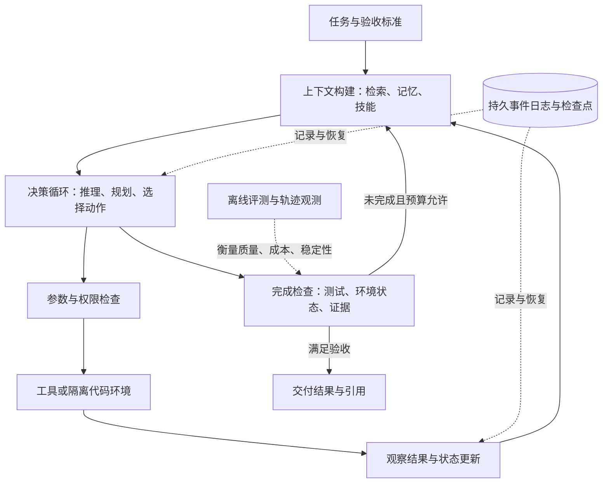

# 从 ReAct 到可持续运行的 Agent：论文与工程架构调研

检索日期：2026-10-25。本文将 React 理解为 Agent 领域的 ReAct（Reasoning and Acting）。

## 摘要

本调研连接两类材料：2023—2026 年的 Agent 方法论文，以及当前官方框架、协议和工程报告。研究问题是：ReAct 的哪些局限得到后续方法补充；Agent 的核心组件各自负责什么；如何选择可验证的实现架构。结论应限定在来源覆盖的任务、模型和评测条件内，不能把单篇工作的提升当作普遍规律。

## 1. 范围与检索方法

- RQ1：ReAct 之后，规划、反思、工具使用和上下文管理如何发展？
- RQ2：当前 Agent 的运行时、记忆、工具协议、技能、协作和评测如何分工？
- RQ3：什么条件下应使用单 Agent、固定工作流、搜索树或多 Agent？

采用三个并行检索视角：方法论文；工程框架与协议；评测与失败分析。补充检索长期任务、上下文管理和 2026 年资料。关键词包括 ReAct、Reflexion、CodeAct、Search-R1、agent harness、context engineering、MCP、A2A、agent evaluation。优先使用会议论文集、OpenReview、arXiv、作者项目及厂商官方文档。会议年份与预印本首发年份分开；在审稿件不计为已发表顶会论文。本文是有针对性的研究地图，并非穷尽检索或按 PRISMA 执行的系统综述；主要核对摘要、元数据与官方技术说明，未独立复现实验。

## 2. 分类框架

| 层次 | 需要回答的问题 | 典型材料 |
|---|---|---|
| 决策方法 | 下一步做什么、何时重试和结束？ | ReAct、Reflexion、LATS |
| 行动表示与学习 | 如何调用工具、如何学会调用？ | Toolformer、CodeAct、Search-R1 |
| 信息管理 | 当前需要哪些证据、跨会话保留什么？ | Context engineering、RLM、记忆评测 |
| 执行基础设施 | 如何持久化、恢复、中断和隔离执行？ | LangGraph、Agent SDK、Managed Agents |
| 能力与互操作 | 如何复用流程、连接工具及其他 Agent？ | Skills、MCP、A2A |
| 验证 | 结果是否正确、稳定、经济？ | SWE-bench、τ-bench、轨迹与结果评测 |

同一系统可以跨越多层：例如 ReAct 是决策循环，MCP 是接口协议，LangGraph 是运行与编排基础设施，三者可以同时使用。

## 3. ReAct 相关论文与评测

以下局限是基于方法与证据范围的阅读判断，不冒充已经独立复现的实验结论。

| 论文 | 会议与年份 | 核心贡献 | 应关注的边界 |
|---|---|---|---|
| [ReAct: Synergizing Reasoning and Acting in Language Models](https://arxiv.org/abs/2210.03629) | ICLR 2023；2022 预印本 | 交错推理、动作与观察，建立交互循环基线 | 单条轨迹错误累积；文字推理不保证执行正确 |
| [Toolformer: Language Models Can Teach Themselves to Use Tools](https://proceedings.neurips.cc/paper_files/paper/2023/hash/d842425e4bf79ba039352da0f658a906-Abstract-Conference.html) | NeurIPS 2023；Meta FAIR | 自监督生成和筛选 API 调用训练数据 | 有限工具上的学习不能直接证明开放环境长程执行能力 |
| [Reflexion: Language Agents with Verbal Reinforcement Learning](https://proceedings.neurips.cc/paper_files/paper/2023/hash/1b44b878bb782e6954cd888628510e90-Abstract-Conference.html) | NeurIPS 2023 | 将失败反馈变成语言反思并存入情景记忆，无需参数更新 | 反馈可靠性与重试费用决定价值；不能等同于参数强化学习 |
| [Tree of Thoughts: Deliberate Problem Solving with Large Language Models](https://papers.nips.cc/paper/2023/hash/271db9922b8d1f4dd7aaef84ed5ac703-Abstract-Conference.html) | NeurIPS 2023 | 思维分支、评估、回溯 | 与 ReAct 相邻的方法，原始推理任务不等同真实工具执行 |
| [Reasoning with Language Model is Planning with World Model](https://aclanthology.org/2023.emnlp-main.507/)（RAP） | EMNLP 2023 | LLM 世界模型加 MCTS 规划 | 模拟状态与真实环境可能存在误差 |
| [Language Agent Tree Search Unifies Reasoning, Acting, and Planning in Language Models](https://proceedings.mlr.press/v235/zhou24r.html)（LATS） | ICML 2024 | 统一树搜索、价值评估、反思和真实环境反馈 | rollout 成本，以及环境是否允许回退和重置 |
| [Executable Code Actions Elicit Better LLM Agents](https://proceedings.mlr.press/v235/wang24h.html)（CodeAct） | ICML 2024 | 用可执行 Python 统一动作空间，组合工具并依据执行观察调整 | 需要可靠解释器与执行隔离；代码动作并非所有业务工具的最佳接口 |
| [ToolChain*: Efficient Action Space Navigation in Large Language Models with A* Search](https://proceedings.iclr.cc/paper_files/paper/2024/hash/13250eb13871b3c2c0a0667b54bad165-Abstract-Conference.html) | ICLR 2024 | 在工具动作空间中进行 A* 路径搜索 | 启发式需要适配；不能直接推广经典 A* 保证 |
| [When is Tree Search Useful for LLM Planning? It Depends on the Discriminator](https://aclanthology.org/2024.acl-long.738/) | ACL 2024 | 分析生成器、判别器与规划器关系 | 复杂搜索依赖可靠判别器；文中阈值不宜跨任务泛化 |
| [Search-R1: Training LLMs to Reason and Leverage Search Engines with Reinforcement Learning](https://openreview.net/pdf?id=Rwhi91ideu) | COLM 2025；含 Google Cloud AI Research 合作者 | 在 RL 中学习交错推理与搜索 | 主要证据来自问答检索，不能直接泛化到任意工具；[会议录用名单](https://colmweb.org/2025/AcceptedPapers.html) |
| [ReTool: Reinforcement Learning for Strategic Tool Use in LLMs](https://arxiv.org/abs/2504.11536) | 2025 预印本；本轮未核实顶会录用 | 学习长推理过程中代码工具的使用时机 | 工具学习的相邻工作，勿标成已确认顶会论文 |

ReAct 通过环境观察调整单条行动轨迹，Reflexion 在跨尝试层面保留语言反馈；LATS 则把试探扩展成多路径搜索。后二者都可能增加计算与交互费用。Search-R1 与这些推理时控制方法的区别在于训练策略本身，使模型学习何时检索；Toolformer 也学习工具使用，但采用自监督 API 数据构建路径。方法比较必须同时考虑训练成本与推理预算。

判别器论文提供了反向阅读视角：当候选方案评价不可靠时，增加搜索深度并不自动提高结果质量。它支持对 LATS 等搜索架构开展评价器消融，但其具体实验阈值不应推广为 Agent 的普遍定律。

| 评测或对照工作 | 会议或状态 | 对架构选择的意义 |
|---|---|---|
| [AgentBench: Evaluating LLMs as Agents](https://proceedings.iclr.cc/paper_files/paper/2024/hash/e9df36b21ff4ee211a8b71ee8b7e9f57-Abstract-Conference.html) | ICLR 2024；2023 预印本 | 在多类交互环境衡量长期推理、决策和指令遵循 |
| [SWE-bench: Can Language Models Resolve Real-world GitHub Issues?](https://proceedings.iclr.cc/paper_files/paper/2024/hash/edac78c3e300629acfe6cbe9ca88fb84-Abstract-Conference.html) | ICLR 2024；2023 预印本 | 用真实仓库 issue 与测试检验最终代码状态 |
| [τ-bench: A Benchmark for Tool-Agent-User Interaction in Real-World Domains](https://openreview.net/pdf?id=roNSXZpUDN) | ICLR 2025；2024 预印本 | 同时检验工具、用户交互、政策和数据库结果；pass^k 衡量 k 次全部成功，区别于 pass@k |
| [τ²-Bench: Evaluating Conversational Agents in a Dual-Control Environment](https://arxiv.org/abs/2506.07982) | 2025 预印本，本轮未核实会议 | 用户也能改变环境，强调沟通协调与状态一致性 |
| [Demystifying LLM-based Software Engineering Agents](https://conf.researchr.org/details/fse-2025/fse-2025-research-papers/85/Demystifying-LLM-based-Software-Engineering-Agents)（Agentless） | FSE 2025 | 定位、修复、验证的固定流程是值得比较的基线，不能预设自主循环总占优 |

## 4. 2025—2026 年工程材料：从循环转向运行系统

| 来源 | 日期或状态 | 重点与阅读价值 |
|---|---|---|
| [Building effective agents](https://www.anthropic.com/engineering/building-effective-agents) | Anthropic，2024-12 | 区分预先定义控制流的 workflow 与模型动态决定过程的 agent；介绍路由、并行、协调者与工作者、评估优化等模式。 |
| [How we built our multi-agent research system](https://www.anthropic.com/engineering/multi-agent-research-system) | Anthropic，2025-06-13 | 研究任务采用主 Agent 与并行子 Agent，结合计划持久化、引用校验和结果工件；适合可拆分的广度搜索。 |
| [Effective context engineering for AI agents](https://www.anthropic.com/engineering/effective-context-engineering-for-ai-agents) | Anthropic，2025-09-29 | 将上下文视为有限资源，讨论即时检索、压缩、笔记和子 Agent；需要管理整个信息状态。 |
| [Equipping agents for the real world with Agent Skills](https://www.anthropic.com/research/equipping-agents-for-the-real-world-with-agent-skills) | Anthropic，2025-10-16 | 通过可动态发现与加载的说明、脚本及资源文件夹复用领域流程。 |
| [Code execution with MCP](https://www.anthropic.com/engineering/code-execution-with-mcp) | Anthropic，2025-11 | 按需加载工具，先在代码环境过滤、组合数据，再把必要信息送入模型上下文。 |
| [Demystifying evals for AI agents](https://www.anthropic.com/engineering/demystifying-evals-for-ai-agents) | Anthropic，2026-01-09 | 区分任务、试次、轨迹、最终环境状态与评测 harness；组合代码、模型和人工评分。 |
| [Harness design for long-running application development](https://www.anthropic.com/engineering/harness-design-long-running-apps) | Anthropic，2026-03-24 | planner、generator、evaluator 三角色；结构化工件跨会话交接，独立评价并迭代。 |
| [Scaling Managed Agents: Decoupling the brain from the hands](https://www.anthropic.com/engineering/managed-agents) | Anthropic，2026-04-08 | 将 session 事件日志、harness 决策循环、sandbox 执行环境分离，支持独立恢复和替换。 |
| [A practical guide to building agents](https://openai.com/business/guides-and-resources/a-practical-guide-to-building-ai-agents/) | OpenAI，官方工程指南；当前网页标注 2026-01-15 | 模型、工具、指令、guardrails，以及 manager 和 handoff 模式；建议先充分发挥单 Agent。原始 PDF 曾更早传播，不以当前网页日期断言首次发布日期。 |

上述均为厂商指南或工程经验，不能视为经过统一基准验证的最优架构。Anthropic 的多 Agent 研究系统针对可并行信息探索，而 OpenAI 的单 Agent 优先建议针对复杂度控制；二者适用条件不同。2026 年 Managed Agents 文章进一步指出，旧模型需要的上下文重置机制可能随模型提升而失去价值。因此，架构应随模型和任务重新评测。

## 5. 2026 年值得跟踪的方法

**Recursive Language Models（RLM）**：[论文](https://arxiv.org/abs/2512.24601)、[作者解读](https://alexzhang13.github.io/blog/2025/rlm/)、[代码](https://github.com/alexzhang13/rlm)。2025-12 首发，2026 年更新；作者主页称已被 NeurIPS 2026 接收，此处明确以作者页面为会议状态依据。其方法把长输入放到外部环境，让模型用代码检查、切分并递归调用模型处理片段。与将全部历史塞进上下文相比，它改变了读取信息的方式；其长文本基准结果不等于所有长期 Agent 任务都适用。

**DeReAct: Decomposed Reasoning and Acting for Reliable AI Agents**：[论文](https://arxiv.org/abs/2610.02351)。2026-10-01 预印本，未核实顶会接收。将动作审批交给 Critic，将有证据支持的状态重建与完成认证交给 Context Manager。论文报告较弱 Brain 模型收益更明显，较强模型下成功率收益缩小；值得研究的是外部完成控制，而不是假设增加角色总能提高准确率。

**AgentArch: A Comprehensive Benchmark to Evaluate Agent Architectures in Enterprise**：[论文](https://arxiv.org/abs/2509.10769)。2025 首发、2026-01 更新，本文按预印本列入。比较 18 种配置，涉及编排、ReAct 与 function calling、记忆、thinking tool，报告不同模型有不同架构偏好。注意论文中的 ReAct/function calling 是具体实现配置的比较：从概念上，结构化函数调用也能实现 ReAct 循环。

## 6. 当前组件、框架与协议

| 组件及官方链接 | 作用 | 使用时的区分 |
|---|---|---|
| [LangChain / LangGraph / Deep Agents](https://www.langchain.com/oss-overview) | LangChain 提供模型工具循环与 middleware；LangGraph 提供持久图执行、恢复和中断；Deep Agents 提供规划、记忆、子 Agent 等 harness 能力 | 先按所需控制程度选层次，无需把三层都自行重做 |
| [OpenAI Agents SDK](https://developers.openai.com/api/docs/guides/agents/sdk) | Agent loop、工具、handoff、guardrails、tracing | SDK 需要应用负责部署和存储；[handoff 与 agent-as-tool](https://developers.openai.com/api/docs/guides/agents/orchestration)的最终责任归属不同 |
| [Microsoft Agent Framework](https://learn.microsoft.com/en-us/agent-framework/overview/agent-framework-overview) | agents、harness、workflow、集成；官方称为 AutoGen 与 Semantic Kernel 的直接继任 | 调研已有 AutoGen 文献时应补看该后续框架；各语言成熟度需分别核对 |
| [Google ADK 官方文档源码](https://github.com/google/adk-docs/blob/main/docs/agents/index.md) | 从单 Agent 到多 Agent 和图工作流的开发框架 | 旧站正在重定向，本轮多 Agent 网页未完整读取；此行仅据官方文档源码作概览 |
| [MCP 架构](https://modelcontextprotocol.io/docs/learn/architecture) | Host、Client、Server 连接 tools、resources、prompts | 是能力与上下文交换协议，不规定规划或记忆策略 |
| [A2A 核心概念](https://a2a-protocol.org/latest/topics/key-concepts/) | Agent Card、Task、Message、Artifact；发现与调用远程 Agent，处理长任务结果 | 更适合独立远端 Agent 的协作；本地函数或进程间协作未必需要 A2A |
| [Agent Skills](https://www.anthropic.com/research/equipping-agents-for-the-real-world-with-agent-skills) | 按需加载说明、脚本和资源，复用领域流程 | Skills 描述做事方法，工具提供执行动作，二者组合 |
| [Context engineering](https://www.anthropic.com/engineering/effective-context-engineering-for-ai-agents) | 检索、压缩、笔记、上下文隔离 | 检索资料、会话状态、长期记忆分别设计；向量库只是可选存储方式 |

综合这些资料，可把运行系统拆成：模型决策、上下文构建、工具适配、持久状态、执行隔离、编排与完成检查、观测评测。ReAct 与 function calling 并不互斥；MCP 与 A2A 也不能替代权限控制、完成验收或端到端评测。

## 7. 建议实现与评测方案

以下是基于资料的工程综合建议，不是某篇论文原样给出的架构。

第一版建议采用单 Agent 加工具循环，持久化任务、工具结果、产物路径与检查点；检索和技能按需加载。规划只用于任务确实需要分解的情况；重试受最大步数、时间和费用限制；完成检查尽量使用测试、数据库或文件状态等外部证据。

固定流程、分支明确的业务适合 workflow；可并行且返回结构化证据的研究任务适合 coordinator-worker；代码生成适合生成与独立验证循环；只有候选路径质量确实影响结果、且有可靠评价函数时才考虑树搜索。多 Agent 需要额外测量通信损耗、共享状态冲突和总费用。

至少比较以下消融：A 基础 ReAct；B 加独立完成检查；C 加按需上下文与持久记忆；D 按任务需要加入多 Agent 或搜索。固定模型、工具、任务集与预算，重复运行。记录成功率、重复运行一致性、约束违规、工具失败恢复率、延迟、token 和单任务成本。不要仅凭语言模型自述“完成”判断成功。

## 8. 开放问题

1. **外部验证何时值得其成本？** DeReAct 中强模型收益缩小，提示应测量失败类型与验证器能力的匹配，而不是统一添加 reviewer。
2. **压缩如何保留未来需要的证据？** Context engineering 的压缩与 RLM 的外部按需读取提供不同取舍；应分别测量证据遗漏、读取费用和恢复能力。
3. **模型升级后哪些脚手架需要删除？** Managed Agents 的经验提示应对规划、重置、反思模块重新消融，避免历史补丁长期累积。
4. **多 Agent 是否在相同预算下更有效？** 应同时控制 token、工具次数和墙钟时间，并区分广度搜索与强依赖顺序执行任务。

## 9. 对研究问题的回答

RQ1：后续研究从局部反思、路径搜索、行动表示和工具学习补充 ReAct；上下文与完成判定仍需要单独设计。

RQ2：应将决策方法、运行时、持久状态、执行环境、能力包、接口协议、协作及评测区分开。它们解决不同问题，可以组合使用。

RQ3：先建立可测的单 Agent 基线；以实际失败类型决定引入 workflow、搜索、记忆或协作。当前证据不足以支持一种架构普遍最佳。

## 阅读顺序

第一轮：ReAct → Reflexion → Building effective agents → Context engineering → Demystifying evals。

第二轮：LATS 与判别器论文配对阅读 → Search-R1 → Agentless 与 SWE-bench 配对阅读。

第三轮：RLM → 2026 长期开发 harness → Managed Agents → DeReAct。围绕“怎样管理状态与验证完成”比较论文设计与工程取舍。

参考来源已在各表中逐项链接到原始论文、会议页或官方文档；动态网站以本次检索日期为准。
